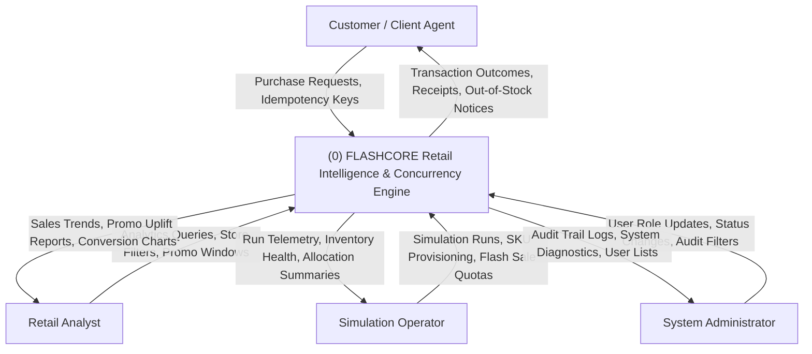
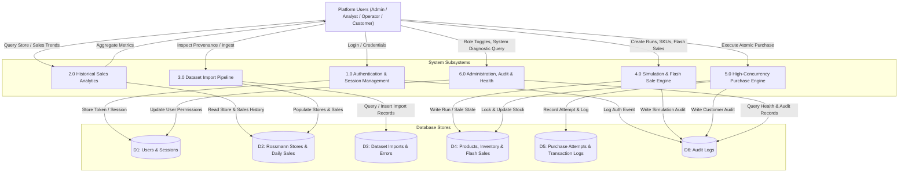

# FLASHCORE — Data Flow Diagrams & System Workflows Specification
## DFD Levels 0, 1, 2, Interaction Workflows & UML Sequence Architecture

> **Project:** FLASHCORE — Retail Intelligence & High-Concurrency Simulation Platform  
> **Course:** B.Tech Capstone Project in Computer Science & Engineering  
> **Author:** Antigravity (Lead Systems Architect & Software Engineer)  
> **Target Commit:** `50916f873066e0e25e7a0fec0673efb875a1a0df` (`50916f8`)  
> **Status:** Stage 4 Final Academic Specification  

---

## 1. Data Flow Diagrams (DFDs)

### 1.1 DFD Level 0: Context Diagram

The Context Diagram defines the system boundary of the FLASHCORE platform, illustrating high-level data exchanges between external entities and the centralized retail engine.



---

### 1.2 DFD Level 1: Major System Processes

The Level 1 DFD decomposes the system into six primary operational subsystems interacting with dedicated relational data stores.



---

### 1.3 DFD Level 2: High-Concurrency Retail Simulation Workflow

The Level 2 DFD details the internal transactional stages of the commerce purchase pipeline, demonstrating how concurrency locks and idempotency checks are sequenced.

```mermaid
flowchart TD
    Req["Incoming Purchase Request {customer_ref, key, qty}"]
    P51["5.1 Fast Idempotency Verification"]
    P52["5.2 Row-Level Pessimistic Locking"]
    P53["5.3 Sale & Time Window Validation"]
    P54["5.4 Quota & Physical Stock Check"]
    P55["5.5 Customer Double-Purchase Guard"]
    P56["5.6 Atomic Stock Decrement & Logging"]
    P57["5.7 Idempotency Conflict Fallback (On Exception)"]

    DB_Attempts[("purchase_attempts")]
    DB_Products[("flash_sale_products (FOR UPDATE)")]
    DB_Inv[("simulation_inventory (FOR UPDATE)")]
    DB_Trans[("transactions_log")]
    DB_Audit[("audit_logs")]

    Req --> P51
    P51 -->|Query Key| DB_Attempts
    P51 -->|Key Found (Duplicate)| RetDup["Return Cached Attempt"]

    P51 -->|Key Fresh| P52
    P52 -->|Acquire Lock| DB_Products
    P52 -->|Acquire Lock| DB_Inv

    P52 --> P53
    P53 -->|Window Expired or Sale Inactive| Reject["Record Rejection Attempt"]

    P53 -->|Window Valid| P54
    P54 -->|Stock Limit Exceeded| Reject
    P54 -->|Stock Sufficient| P55

    P55 -->|Customer Already Purchased| Reject
    P55 -->|Customer Allowed| P56

    P56 -->|Deduct Physical & Reserved Stock| DB_Inv
    P56 -->|Increment Sold Quota| DB_Products
    P56 -->|Write Success Attempt| DB_Attempts
    P56 -->|Write Transaction Log| DB_Trans
    P56 -->|Write Audit Log| DB_Audit
    P56 --> Commit["COMMIT Transaction -> HTTP 200 Success"]

    Reject -->|Record Rejection Entry| DB_Attempts
    Reject -->|Record Audit Entry| DB_Audit
    Reject --> CommitRej["COMMIT Transaction -> HTTP 200 Rejection Info"]

    P56 -.->|On Microsecond Duplicate Arrival Collision| P57
    P57 -->|ROLLBACK Dirty Transaction| DB_Attempts
    P57 -->|Fetch Committed Winning Attempt| DB_Attempts
    P57 --> RetDup
```

---

## 2. Comprehensive System Workflows

### 2.1 Workflow 1: User Registration
1. Client submits email and password (`min_length: 12`) to `POST /api/auth/signup`.
2. Backend normalizes email to lowercase and validates regex structure.
3. System queries `users` table for duplicate email collision (case-insensitively). If duplicate, returns `HTTP 409 Conflict`.
4. Password is cryptographically hashed via Argon2id (`pwdlib.PasswordHash.recommended()`).
5. User is created with default role `analyst` and status `active`.
6. Session token with UUIDv4 JTI is generated, inserted into `auth_sessions`, and returned with `HTTP 201 Created`.
7. Audit event `user_created` is logged.

### 2.2 Workflow 2: User Authentication & JWT Issuance
1. Client submits credentials to `POST /api/auth/login`.
2. User record retrieved by lowercase email.
3. Argon2id hash verified against provided password.
4. If invalid, returns `HTTP 401 Unauthorized: "Invalid email or password."`
5. If user status is `disabled`, returns `HTTP 403 Forbidden: "Account is disabled."`
6. System issues HS256 JWT access token with claims `sub`, `jti`, `iat`, `exp`, `iss`, valid for 30 minutes.
7. Active session stored in `auth_sessions`.

### 2.3 Workflow 3: Role-Based Access Control (RBAC) Enforcement
1. Every protected request includes `Authorization: Bearer <token>`.
2. FastAPI dependency `get_current_user()` decodes token and extracts JTI.
3. System verifies JTI in `auth_sessions`: checks that session exists, user ID matches, expiration is in the future, and `revoked_at` is `NULL`.
4. Dependency `require_roles(*allowed_roles)` asserts user role is permitted.
5. If unauthorized, returns `HTTP 403 Forbidden: "You do not have permission to perform this action."`

### 2.4 Workflow 4: Dataset Import Provenance Tracking
1. Dataset imports are recorded in `dataset_imports` with SHA-256 checksums, total rows, successful rows, and rejection counts.
2. Row-level errors are written to `dataset_import_errors`.
3. Analysts and Admins query `GET /api/imports` to inspect ingestion provenance.

### 2.5 Workflow 5: Retail Simulation Run Lifecycle
1. Operator creates simulation run via `POST /api/simulations/runs` with JSONB parameters.
2. Run starts in status `created`.
3. Run is activated via `POST /api/simulations/runs/{id}/activate` (`running`).
4. Products and inventory are provisioned under the run.
5. Operator inspects real-time summary via `GET /api/simulations/runs/{id}/summary`.

### 2.6 Workflow 6: Inventory Allocation & Adjustments
1. Products created with unique SKUs (`POST /api/simulations/products`).
2. Physical inventory assigned to stores (`POST /api/simulations/inventory`).
3. Store inventory can be adjusted via delta updates (`POST /api/simulations/inventory/{id}/adjust`) with mandatory reason logging.
4. System prevents adjustments that would reduce physical stock below reserved quotas.

### 2.7 Workflow 7: High-Concurrency Flash Sale Execution
1. Flash sale scheduled with `starts_at` and `ends_at`.
2. Products allocated with discounted prices and stock limits.
3. Flash sale activated manually or automatically upon start time arrival.
4. Purchases execute with pessimistic row locks.
5. Inventory decremented atomically; overselling strictly prevented.

### 2.8 Workflow 8: Idempotent Purchase Processing
1. Client provides `idempotency_key` (UUIDv4) with purchase payload.
2. Initial check checks `purchase_attempts` for key existence.
3. If fresh, attempts row lock on sale product and executes purchase.
4. If duplicate key arrives concurrently, PostgreSQL unique constraint catches it, triggers savepoint rollback, and returns the existing attempt payload.

### 2.9 Workflow 9: Immutable Audit Logging & Secret Scrubbing
1. Operational events invoke `write_audit(db, action, entity, id, details)`.
2. Record persisted to `audit_logs` with actor reference and timestamp.
3. Administrative reads through `GET /api/admin/audit-logs` scrub all sensitive keys (`password`, `token`, `secret`, `hash`, `key`, `auth`) to `"[REDACTED]"`.

### 2.10 Workflow 10: System Health Monitoring & Graceful Degradation
1. Uptime probes query `GET /api/health` and `GET /api/health/database`.
2. Real-time ping executed via `SELECT current_database()`.
3. If database is reachable: returns `status: "healthy"`.
4. If database is unreachable: catches exception, returns `status: "degraded"`, and logs component failure without terminating server worker.
