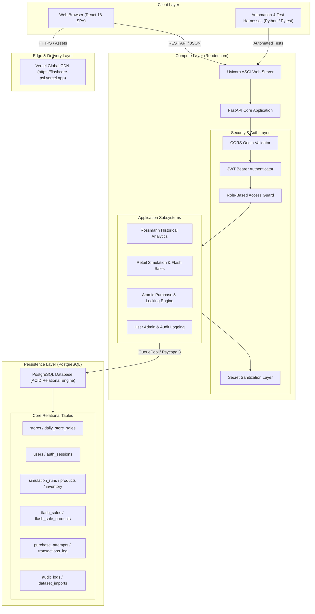
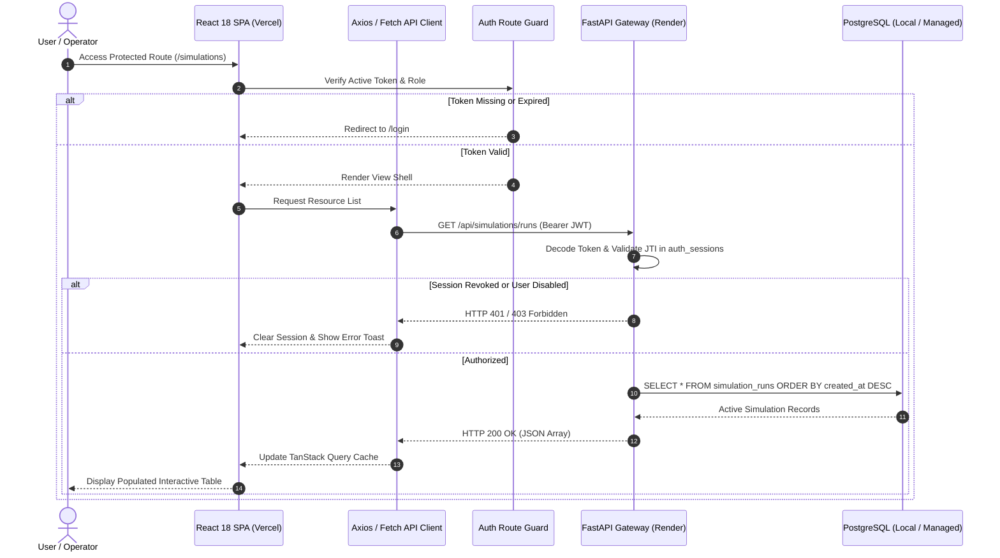
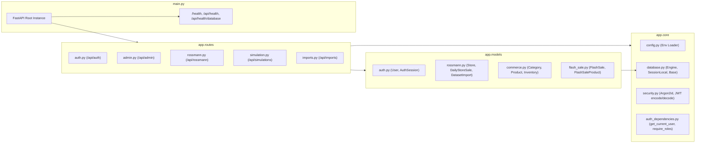
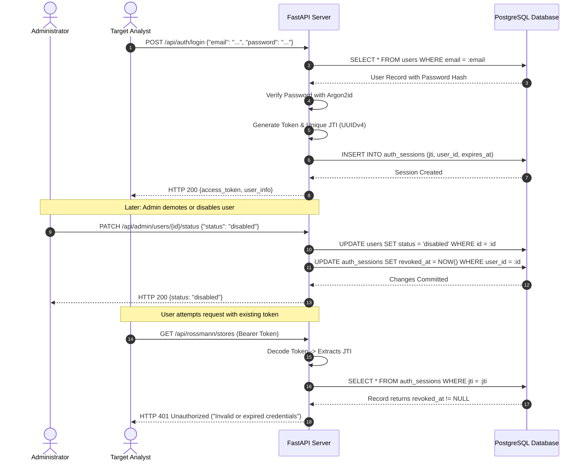
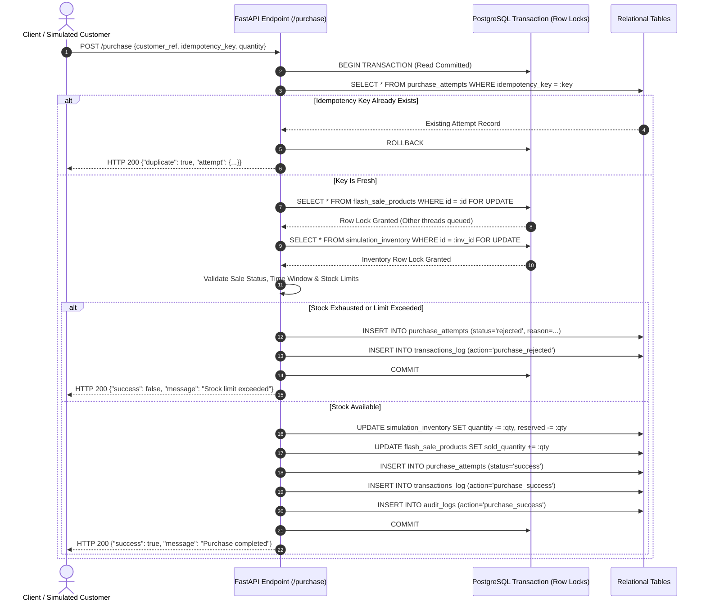
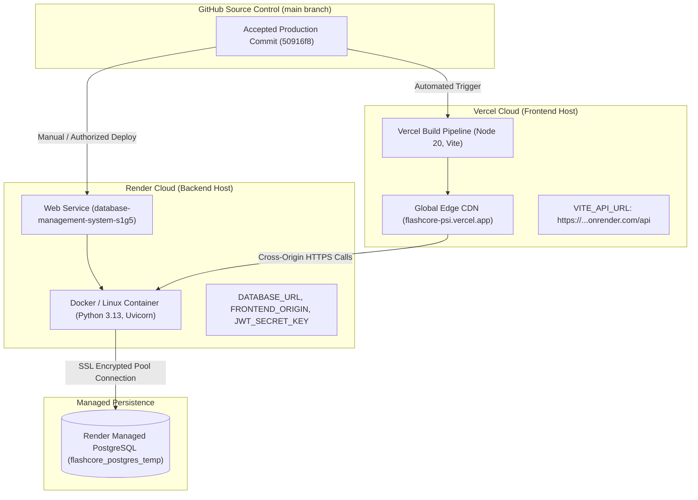

# FLASHCORE — System Architecture & Component Design
## High-Concurrency E-Commerce & Retail Intelligence Platform Architecture

> **Student:** Manas Aggarwal (Roll No. 2501730302)  
> **Course / Programme:** B.Tech CSE (AI/ML), 3rd Semester, Section A  
> **Supervisor:** Ms. Mansi Kajal, Assistant Professor, SOET, K.R. Mangalam University  
> **Repository:** `https://github.com/manasaggarwal1107-ctrl/DATABASE-MANAGEMENT-SYSTEM.git`  
> **Verification Status:** Fully Verified against Codebase & Test Suites  

---

# FLASHCORE — System Architecture Documentation
## Retail Intelligence & High-Concurrency Simulation Platform

> **Project:** FLASHCORE  
> **Course:** B.Tech Capstone Project in Computer Science & Engineering  
> **Repository:** `https://github.com/manasaggarwal1107-ctrl/DATABASE-MANAGEMENT-SYSTEM.git`  
> **Live Production Frontend:** `https://flashcore-psi.vercel.app`  
> **Live Production Backend:** `https://database-management-system-s1g5.onrender.com`  
> **Author:** Antigravity (Lead Systems Architect & DevOps Engineer)  
> **Target Production Commit:** `50916f873066e0e25e7a0fec0673efb875a1a0df` (`50916f8`)  
> **Status:** Stage 4 Final Academic Architecture Specification  

---

## 1. System Overview

FLASHCORE is an enterprise-grade retail intelligence analytics and high-concurrency simulation platform. It bridges historical retail operations analytics—powered by authentic Rossmann historical store sales data (spanning 1,115 physical retail pharmacies across Europe)—with an active, high-throughput e-commerce flash-sale simulation engine. 

The platform enables retail analysts to model demand fluctuations, evaluate promotional efficacy, test stock allocation policies, and stress-test inventory reservation algorithms under extreme concurrency scenarios (e.g., flash sales, sudden demand spikes, and product drops).

---

## 2. Problem Statement

Modern omni-channel retail systems suffer from two interconnected architectural challenges:
1. **Analytical Disconnection:** Traditional ERP and sales forecasting systems analyze historical transactions offline in batch cycles, separating planning data from execution platforms. Store managers cannot simulate how historical seasonal surges or promotional campaigns will stress live digital inventory.
2. **High-Concurrency Inventory Hazards:** During sudden flash sales and promotional bursts, e-commerce transaction engines face classic concurrency hazards:
   - **Overselling (Phantom Stock):** Competing threads read inventory simultaneously, leading to sold quantities exceeding available physical stock.
   - **Duplicate Decrements:** Network timeouts cause clients to retry requests, resulting in double-charges or multiple stock deductions without idempotent locking.
   - **Database Deadlocks:** Uncoordinated resource acquisition across store inventory and flash sale product allocations causes circular database locks, degrading throughput and causing transaction aborts.

FLASHCORE addresses both challenges within a unified, ACID-compliant reactive architecture.

---

## 3. Project Objectives

1. **Historical Intelligence:** Ingest, index, and analyze over 1,115 store profiles and daily sales time-series records from the Rossmann dataset to evaluate promotional uplift and store-level trends.
2. **Realistic Retail Simulation:** Provide a configurable simulation engine allowing operators to create simulation runs, provision products with SKUs, allocate store-level inventory, and launch time-bounded flash sales.
3. **Pessimistic Row-Level Concurrency Control:** Guarantee zero overselling and exact stock decrement under heavy burst traffic through explicit PostgreSQL row-level locks (`SELECT ... FOR UPDATE`).
4. **Sub-Millisecond Idempotency Enforcement:** Eliminate duplicate charges and transactions through cryptographic UUID idempotency keys backed by PostgreSQL unique constraints and savepoint rollbacks.
5. **Strict Role-Based Access Control (RBAC):** Implement three distinct user roles (`admin`, `analyst`, `operator`) with zero privilege leakage, session invalidation upon status/role mutation, and complete audit logging.
6. **Dual Cloud Deployment Parity:** Maintain high availability and zero-downtime continuous deployment across Vercel (Edge SPA frontend) and Render (containerized FastAPI backend).

---

## 4. Scope and Limitations

### In Scope
- Fast historical queries over stores, assortment types, competition distance, and promotional windows.
- Dynamic retail simulation creation with stateful lifecycle management (`created` -> `running` -> `completed`).
- Flash sales scheduling with automatic time-based state transitions (`scheduled` -> `active` -> `ended`).
- ACID inventory decrements, transaction logging (`transactions_log`), and audit trails (`audit_logs`).
- Automated recursive sanitization of credentials, JWT tokens, and sensitive metadata.
- Automated health monitoring (`/api/health`, `/api/health/database`) with graceful degradation.

### Out of Scope / Limitations
- Direct hardware point-of-sale (POS) barcode scanner hardware drivers.
- Third-party payment gateway merchant settlement (purchases are simulated through tokenized customer references).
- Server-Side Rendering (SSR) — the frontend operates purely as a high-performance client-side Single Page Application (SPA).

---

## 5. Functional Requirements

- **FR-1: User Lifecycle & Authentication:** Self-service registration (default role: `analyst`), case-insensitive email authentication, Argon2id password hashing, and HS256 JWT access tokens with 30-minute lifetimes.
- **FR-2: Role-Based Access Control:**
  - `Admin`: Full access to user management, role modification, status toggling, audit logs, simulation execution, and analytics.
  - `Analyst`: Read access to Rossmann stores, sales trends, promotional analyses, simulation outputs, and conversion analytics.
  - `Operator`: Execution access to simulation runs, product provisioning, inventory allocations, and simulated customer purchase triggers.
- **FR-3: Retail Simulation Engine:** Create runs, register SKU products, assign store-level inventory, schedule flash sales, and allocate stock quotas.
- **FR-4: High-Concurrency Commerce Engine:** Execute atomic purchases with customer verification, inventory availability checks, and idempotent execution.
- **FR-5: Audit Trail & Provenance:** Record all operational mutations to an immutable audit log with automated secret redaction.

---

## 6. Non-Functional Requirements

- **NFR-1 (Consistency):** Strict ACID transactional consistency; zero overselling permitted under any concurrent load.
- **NFR-2 (Throughput & Latency):** Read operations must maintain p50 latency < 80ms and throughput > 120 RPS; transactional write operations under row-lock contention must sustain > 100 RPS with p99 latency < 750ms.
- **NFR-3 (Availability):** 99.9% service uptime; health endpoints must return component-level diagnostics without crashing.
- **NFR-4 (Security):** Strict compliance with OWASP Top 10; zero credential or traceback leakage in HTTP 4xx/5xx responses.
- **NFR-5 (Disaster Recovery):** Recovery Point Objective (RPO) < 5 minutes; Recovery Time Objective (RTO) < 60 seconds.

---

## 7. Technology Stack & Rationale

| Layer | Technology | Version | Architectural Rationale |
| :--- | :--- | :---: | :--- |
| **Frontend Framework** | React | 18.3.1 | Declarative component architecture with concurrent rendering and hooks. |
| **Build Tooling** | Vite | 5.4.10 | Extremely fast Hot Module Replacement (HMR) and optimized Rollup production builds. |
| **State & Data Fetching**| TanStack Query | 5.59.0 | Server-state caching, automatic background refetching, and optimistic UI mutations. |
| **Routing** | React Router DOM | 6.28.0 | Declarative client-side routing with authenticated navigation guards. |
| **Styling & Icons** | Tailwind CSS / Lucide | 3.4.14 / 0.460 | Utility-first responsive styling and consistent vector iconography. |
| **Backend Framework** | FastAPI | 0.165.0 | High-performance Python ASGI framework with native OpenAPI schema generation. |
| **Application Server** | Uvicorn | 0.54.0 | Lightning-fast ASGI server implementation powered by `uvloop` and `httptools`. |
| **ORM / Query Engine** | SQLAlchemy | 2.1.9 | Type-safe declarative mapping with native support for PostgreSQL `FOR UPDATE` locks. |
| **Database Driver** | Psycopg 3 | 3.3.9 | Native modern PostgreSQL client with binary wire protocol and connection pooling. |
| **Database Engine** | PostgreSQL | 18 / Managed | Relational ACID database with identity columns, JSONB support, and row locking. |
| **Security & Cryptography**| Pwdlib / PyJWT | 0.4.2 / 2.15.1 | Argon2id recommended password hashing and RFC 7519 compliant JWT generation. |

---

## 8. Architectural Diagrams

### 8.1 High-Level System Architecture

### 8.2 Frontend/Backend Communication Architecture

### 8.3 Backend Module Architecture

### 8.4 Authentication and Session Revocation Flow

### 8.5 Retail Simulation & Concurrency Locking Workflow

### 8.6 Production Cloud Deployment Architecture

